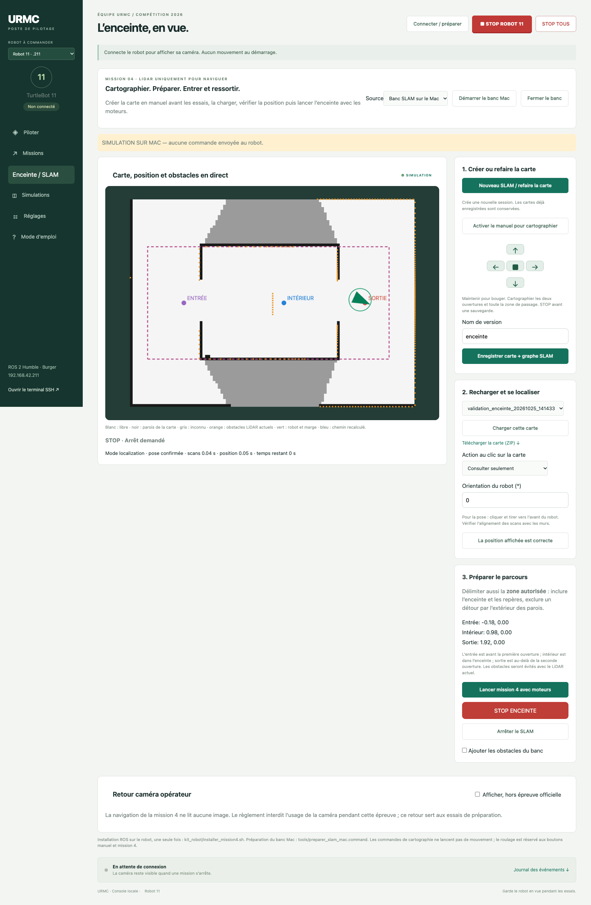

# Mission 4 — Enceinte, SLAM et obstacles

Dans la console du Mac, ouvrir **Missions → 04 → Préparer la mission 4**. Le panneau guide la préparation en trois étapes : **Créer la carte → Dessiner le trajet → Se placer et partir**. Le bouton **Essayer sur le Mac** ouvre directement le mode entraînement, sans commander un robot réel. Le nouveau pilote est un vrai nœud ROS 2 qui commande `/cmd_vel` après un lancement explicite. Il utilise exclusivement le LiDAR, l’odométrie et TF. La caméra du panneau est un retour opérateur optionnel, désactivé par défaut ; le règlement interdit son usage dans cette épreuve.

## Une seule fois : préparer

Cliquer d’abord **Connecter / préparer** pour transférer les nouveaux fichiers. Puis, sur le robot Ubuntu, avec le bouton Terminal SSH :

```bash
bash ~/urmc_essais_20261020/kit_robot/installer_mission4.sh
```

Cela installe SLAM Toolbox, TF2 et YAML. Revenir ensuite à **Connecter / préparer** dans la console : les sources et le package mission 04 sont compilés avec les missions existantes. La préparation ne lance aucun mouvement.

Sur le Mac, pour le banc SLAM complet : double-cliquer `Code/tools/preparer_slam_mac.command`. L’image Docker `urmc-slam:local` est différente de l’ancienne simulation réactive `urmc-humble:local`. Elle contient le vrai SLAM Toolbox.

## 1. Construire la carte avant les essais

1. Choisir le robot 9 ou 11 et cliquer **Connecter / préparer**.
2. Ouvrir **Enceinte / SLAM**, source **Sur le robot réel**.
3. Cliquer **Créer une nouvelle carte**. Une nouvelle session est créée ; les versions enregistrées ne sont pas écrasées.
4. Cliquer **Prendre les commandes**, puis maintenir les flèches et parcourir l’entrée, l’intérieur et la sortie. Relâcher arrête les moteurs. Passer suffisamment près des zones à utiliser pour qu’elles soient connues en blanc sur la carte. Une zone inconnue reste interdite au planificateur.
5. Arrêter. Choisir **Dessiner la zone**, cliquer et tirer un rectangle sur la carte. Il doit inclure l’enceinte et les repères extérieurs, mais interdire un détour qui contournerait les parois par l’extérieur. Cette limite fait partie de la préparation du parcours.
6. Choisir successivement les trois actions au clic : **entrée** juste avant la première ouverture, **intérieur** dans l’enceinte, **sortie** au-delà de la seconde ouverture. Le robot suit ensuite ces repères sans commande manuelle. Éviter de placer un repère contre un mur.
7. Donner un nom simple et cliquer **Enregistrer ma carte et mon parcours**. La sauvegarde porte un horodatage et conserve grille, image PNG, PGM/YAML, graphe `.posegraph`/`.data`, zone et repères.
8. **Télécharger ma carte (ZIP)** copie cette version sur le Mac via le navigateur. Sur le robot, les cartes sont sous `~/urmc_essais_20261020/cartes/`. Elles ne sont pas supprimées par Connecter / préparer.

## 2. Lancer un essai avec obstacles non cartographiés

1. Placer le robot avant l’entrée ; ouvrir **J’ai déjà une carte enregistrée**, choisir la version puis **Utiliser cette carte**. Le système passe en localisation SLAM sur le graphe enregistré.
2. Cliquer **Indiquer la position du robot** : cliquer à sa position et tirer vers son avant, ou utiliser l’angle en degrés. Vérifier que les points LiDAR orange coïncident avec les parois connues.
3. Attendre deux secondes puis cliquer **Oui, le robot est bien placé**. Cette confirmation est nécessaire à chaque rechargement/relocalisation. Une transformation TF récente ne prouve pas à elle seule que la localisation absolue est correcte.
4. Vérifier zone et repères puis **Lancer la mission 4 avec moteurs**. Le mode manuel précédent est arrêté, son autorisation est révoquée, puis le pilote de l’enceinte prend seul les moteurs.
5. Surveiller la carte et la décision. **STOP ENCEINTE**, le STOP rouge ou STOP TOUS arrêtent l’essai. Le SLAM reste disponible pour observer ou préparer le suivant.

La mission vise d’abord l’entrée, puis le point intérieur, puis la sortie. Le chronomètre de 60 s démarre à l’atteinte du repère d’entrée, donc de façon conservatrice avant le franchissement complet. La sortie est validée par l’atteinte du repère extérieur choisi ; c’est pourquoi sa calibration et la zone autorisée comptent.

Le planificateur A* utilise une carte avec empreinte du robot et marge, et y ajoute les obstacles des scans actuels. Le chemin est recalculé environ deux fois par seconde. Un repère intérieur occupé peut être remplacé par un point voisin jusqu’à 25 cm, en restant dans la zone autorisée. Les obstacles ne doivent donc pas être présents dans la carte préalable pour être évités. Si aucun passage connu n’est suffisamment large, le robot attend à l’arrêt ; il ne force pas le passage.

Le dernier contrôle de mouvement vérifie l’empreinte sur la carte et sur les points LiDAR actuels. Une approche trop serrée réduit la vitesse ou l’annule. La navigation ne recule pas automatiquement. Elle ne garantit pas la résolution de tout labyrinthe ni la réussite dans une enceinte bloquée.

## Ce qui s’affiche

- Carte SLAM : blanc libre, noir parois, gris inconnu.
- Robot et empreinte avec marge, position, âge de la localisation.
- Scans orange, y compris les obstacles absents de la carte enregistrée.
- Chemin recalculé, zone autorisée et repères entrée / intérieur / sortie.
- Phase de mission, motif d’arrêt, temps restant, vitesse, tension batterie si publiée par le robot.
- Caméra opérateur sur demande, hors épreuve officielle. Elle ne sert jamais au SLAM ni aux décisions.

Les cartes sont séparées physiquement sur chaque robot et identifiées par leur numéro dans les métadonnées. Une carte simulée du banc n’est pas une carte du terrain réel. Les coordonnées sont dans le repère ROS `map`, distances en mètres. La carte prend en charge une origine orientée.

## Banc SLAM du Mac

Dans **Enceinte / SLAM**, choisir **En entraînement sur le Mac** puis **Démarrer mon entraînement**. Suivre le même parcours création → manuel → zone/repères → sauvegarde → chargement → pose/confirmation → mission. La case **Ajouter un obstacle à l’entraînement** introduit un obstacle après cartographie. Le banc utilise des topics `/urmc_sim/m04_slam/*`, des TF séparés, le domaine 99 et aucun réseau hôte Docker. Il ne commande aucun robot réel.

Les cartes du banc persistent dans le volume Docker `urmc-cartes-simulation`. Utiliser le ZIP pour une copie indépendante sur le Mac. **Fermer le banc Mac** arrête ses processus et conserve ce volume. L’ancienne simulation de mission 4 reste accessible dans l’onglet Simulations ; elle teste le pilote réactif historique, pas ce nouveau workflow SLAM.

## Code associé

- `code/robot/mission_enceinte.py` : SLAM, localisation TF, services HTTP privés et pilote moteur ROS 2.
- `code/perception/enclosure_map.py` : grille métrique, inflation, zone, A*, suivi et contrôle de collision.
- `code/robot/map_store.py` : sauvegardes versionnées et export ZIP.
- `../../kit_robot/mapping_manager.py`, `operator_agent.py` : supervision et exclusivité des moteurs.
- `../../tools/console/mapping.js` : carte et boutons de l’interface.
- `../../tools/sim_enclosure_slam.py`, `container_slam.sh` : banc synthétique avec vrai SLAM Toolbox.

Le pilote historique `urmc_mission_04/logic.py` et ses launch files restent disponibles pour comparaison ; le nouveau mode cartographié de la console n’utilise pas ce pilote réactif.

## Réglages et limites à vérifier sur le robot

Dans **Réglages → Enceinte / SLAM** : vitesse maximale 0,10 m/s initialement, rayon physique 10,5 cm, marge 2,5 cm et tolérance de repère 7 cm. Mesurer réellement le gabarit et vérifier les passages. Les seuils sont bornés, pas automatiquement certifiés pour le montage physique.

Le LiDAR doit couvrir au moins 350°, avec au moins 90 % de mesures valides. Un retour `+inf` signifie libre jusqu’à `range_max`, une valeur invalide ne signifie pas libre. Scanner et odométrie doivent être datés de moins de 300 ms ; TF map→base doit également être récent. Le TF base→LiDAR est obligatoire : aucun décalage de capteur n’est inventé. Un saut de localisation termine l’essai et impose une nouvelle vérification de position.

Les essais logiciels et simulés ne remplacent pas la calibration sur les robots 9/11. SLAM Toolbox doit être installé sur chacun. Le code moteur est prêt pour ces essais supervisés ; aucune réussite physique n’est affirmée.

Documentation amont : [SLAM Toolbox Humble](https://docs.ros.org/en/humble/p/slam_toolbox/), [configuration officielle Humble](https://github.com/SteveMacenski/slam_toolbox/tree/humble/config). Règlement fourni : section 4.2.1, page 5.

## Aperçus du banc validé



Ces vues proviennent du SLAM sur scans synthétiques du banc. Elles ne constituent pas une carte des robots réels.

## Règles résumées

- Perception exclusivement issue du LiDAR ; usage de la caméra interdit durant cette mission.
- Détecter l’ouverture d’entrée, entrer sans toucher les montants, trouver la sortie et sortir sans toucher les murs.
- À l’intérieur, trouver l’issue et sortir dans un délai de 1 minute.
- Répéter l’entrée/sortie avec des obstacles placés aléatoirement.

Barème : 1 point : panneau d’entrée ; 3 points : entrée ; 3 points : sortie ; bonus +3 avec obstacles. −1 si paroi touchée, −1 si chute d’obstacle.

Les [PDF officiels fournis](../../docs/documents/) restent la référence.
